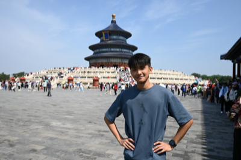
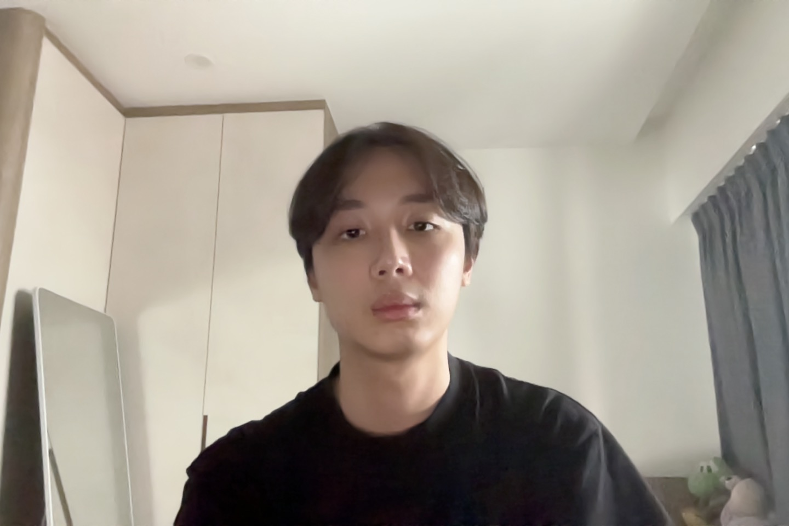
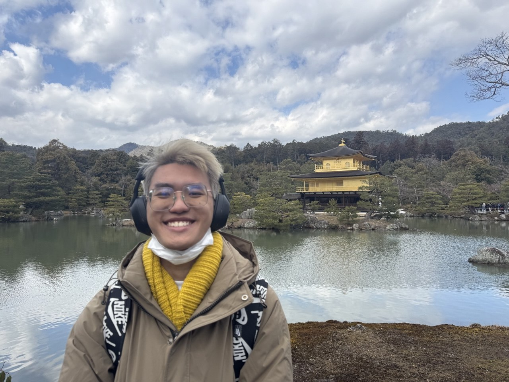
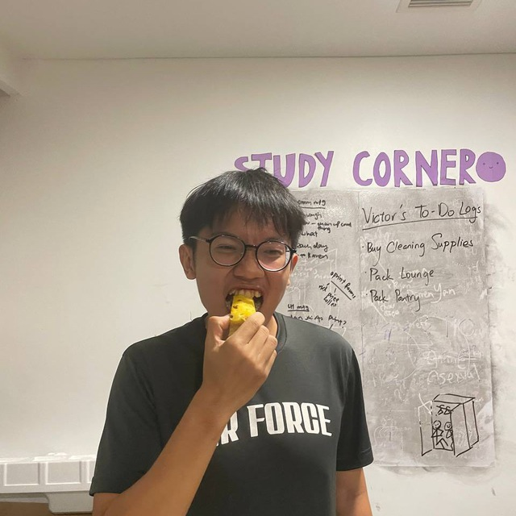
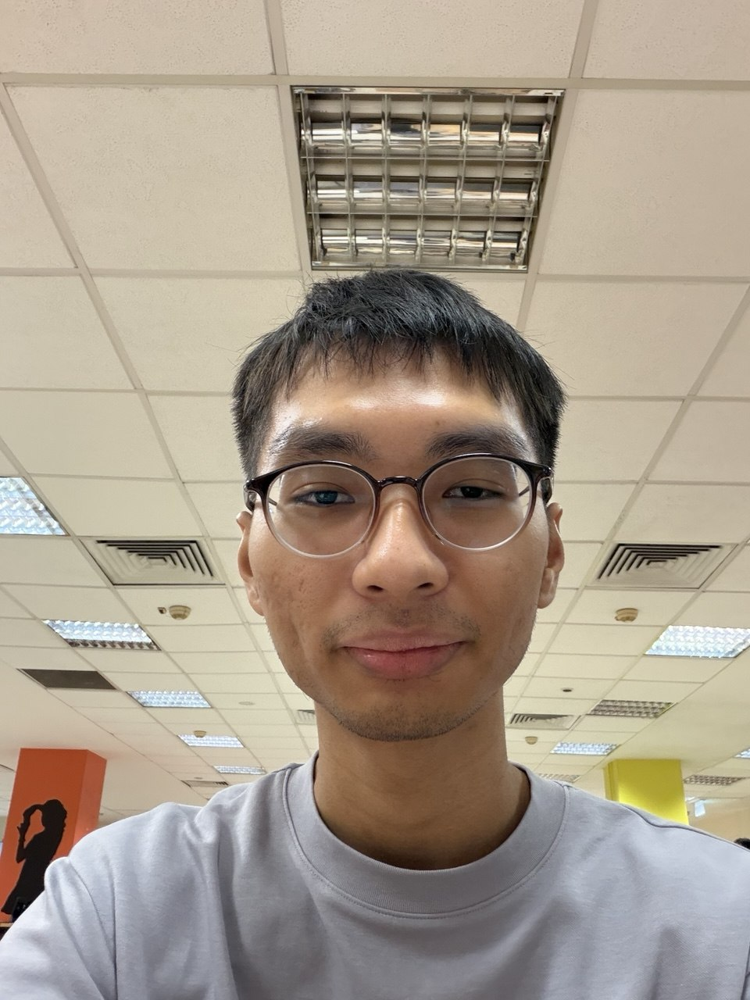

We are a team based in the [School of Computing, National University of Singapore](https://www.comp.nus.edu.sg).

You can reach us by opening an issue on our [GitHub repository](https://github.com/AY2627S1-CS2103T-F13-1/tp/issues).

## Project team

### Ravan

[[github](https://github.com/ravanc)]

* Role: Team Lead
* Responsibilities: UI

### Foo Kee Juan

[[github](http://github.com/keejuanfoo)]

* Role: Product Manager
* Responsibilities: Data + Testing

### Ling Si Han

[[github](https://github.com/LINGSIHAN)]

* Role: Developer
* Responsibilities: Dev Ops + Threading

### Wee Yen Zhe

[[github](https://github.com/randomwish/)]

* Role: Developer
* Responsibilities: UI

### Way Yan

[[homepage](https://wyan.win)]
[[github](http://github.com/greysome)]

* Role: Developer
* Responsibilities: UI
