* Table of Contents
{:toc}

--------------------------------------------------------------------------------------------------------------------

## **Acknowledgements**

* TutorReach is based on the [AddressBook-Level3](https://se-education.org/addressbook-level3/) project created by the [SE-EDU initiative](https://se-education.org).
* Libraries used: [JavaFX](https://openjfx.io/), [Jackson](https://github.com/FasterXML/jackson), [JUnit5](https://github.com/junit-team/junit5)

--------------------------------------------------------------------------------------------------------------------

## **Setting up, getting started**

Refer to the guide [_Setting up and getting started_](SettingUp.md).

--------------------------------------------------------------------------------------------------------------------

## **Design**

:bulb: **Tip:** The `.puml` files used to create diagrams are in `docs/diagrams`. Refer to the [_PlantUML Tutorial_ at se-edu/guides](https://se-education.org/guides/tutorials/plantUml.html) to learn how to create and edit diagrams.

### Architecture

The ***Architecture Diagram*** given above explains the high-level design of the App.

The following provides a quick overview of the main components and their interactions.

**Main components of the architecture**

**`Main`** (consisting of classes [`Main`](https://github.com/AY2627S1-CS2103T-F13-1/tp/tree/master/src/main/java/seedu/address/Main.java) and [`MainApp`](https://github.com/AY2627S1-CS2103T-F13-1/tp/tree/master/src/main/java/seedu/address/MainApp.java)) is in charge of the app launch and shut down.
* At app launch, it initializes the other components in the correct sequence, and connects them up with each other.
* At shut down, it shuts down the other components and invokes cleanup methods where necessary.

The bulk of the app's work is done by the following four components:

* [**`UI`**](#ui-component): The UI of the App.
* [**`Logic`**](#logic-component): The command executor.
* [**`Model`**](#model-component): Holds the data of the App in memory.
* [**`Storage`**](#storage-component): Reads data from, and writes data to, the hard disk.

[**`Commons`**](#common-classes) represents a collection of classes used by multiple other components.

**How the architecture components interact with each other**

The *Sequence Diagram* below shows how the components interact with each other for the scenario where the user issues the command `deletestudent 1`.

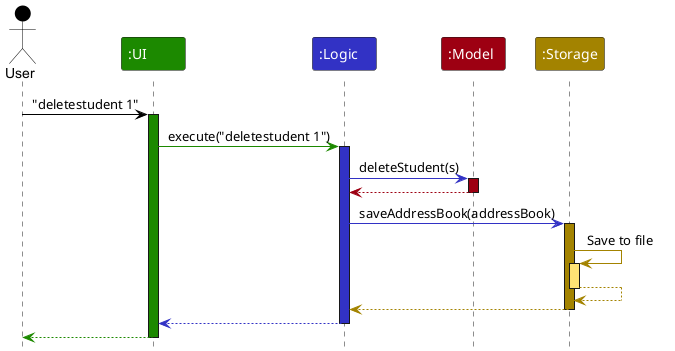

Each of the four main components (also shown in the diagram above),

* defines its *API* in an `interface` with the same name as the Component.
* provides its functionality through a concrete `{Component Name}Manager` class that implements the corresponding API interface.

For example, the `Logic` component defines its API in `Logic.java` and implements it in `LogicManager.java`. Other components interact with a component through its interface rather than its concrete class, preventing them from coupling to that component's implementation, as illustrated in the following partial class diagram.

The sections below give more details of each component.

### UI component

The **API** of this component is specified in [`Ui.java`](https://github.com/AY2627S1-CS2103T-F13-1/tp/tree/master/src/main/java/seedu/address/ui/Ui.java)

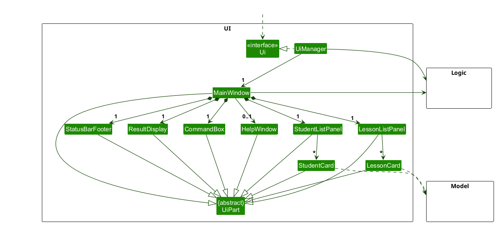

The UI consists of a `MainWindow` and its parts, such as `CommandBox`, `ResultDisplay`, `StudentListPanel`, `LessonListPanel` and `StatusBarFooter`. All of these, including `MainWindow`, inherit from the abstract `UiPart` class, which captures common behavior among classes that represent visible GUI parts.

The `StudentListPanel` and `LessonListPanel` are shown side by side. Each holds one card per item in its list: a `StudentCard` shows a student's phone number, guardian and enrolled lessons, and a `LessonCard` shows a lesson's day, time and enrolled students.

The `UI` component uses the JavaFX UI framework. The layouts of these UI parts are defined in matching `.fxml` files in `src/main/resources/view`. For example, [`MainWindow.fxml`](https://github.com/AY2627S1-CS2103T-F13-1/tp/tree/master/src/main/resources/view/MainWindow.fxml) specifies the layout of [`MainWindow`](https://github.com/AY2627S1-CS2103T-F13-1/tp/tree/master/src/main/java/seedu/address/ui/MainWindow.java).

The `UI` component,

* executes user commands using the `Logic` component.
* listens for changes to `Model` data so that the UI can be updated with the modified data.
* keeps a reference to the `Logic` component, because the `UI` relies on the `Logic` to execute commands.
* depends on some classes in the `Model` component because it displays `Student` and `Lesson` objects from the model.

### Logic component

**API** : [`Logic.java`](https://github.com/AY2627S1-CS2103T-F13-1/tp/tree/master/src/main/java/seedu/address/logic/Logic.java)

Here's a (partial) class diagram of the `Logic` component:

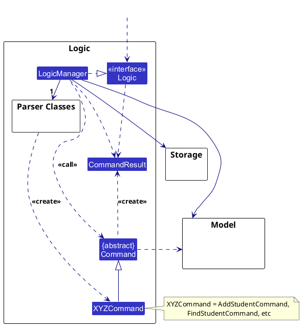

The sequence diagram below illustrates the interactions within the `Logic` component, taking `execute("deletestudent 1")` API call as an example.

:information_source: **Note:** The lifeline for `DeleteStudentCommandParser` should end at the destroy marker (X), but due to a limitation of PlantUML, it continues to the end of the diagram.

How the `Logic` component works:

1. When `Logic` is called upon to execute a command, the command is passed to an `AddressBookParser` object, which in turn creates a parser that matches the command (e.g., `DeleteStudentCommandParser`) and uses it to parse the command.
1. This results in a `Command` object (more precisely, an object of one of its subclasses e.g., `DeleteStudentCommand`) which is executed by the `LogicManager`.
1. The command can communicate with the `Model` when it is executed (e.g. to delete a student). 
   Note that although this is shown as a single step in the diagram above for simplicity, the code can require several interactions between the command object and the `Model` to complete the operation.
1. The result of the command execution is encapsulated as a `CommandResult` object which is returned from `Logic`.

Here are the other classes in `Logic` (omitted from the class diagram above) that are used for parsing a user command:

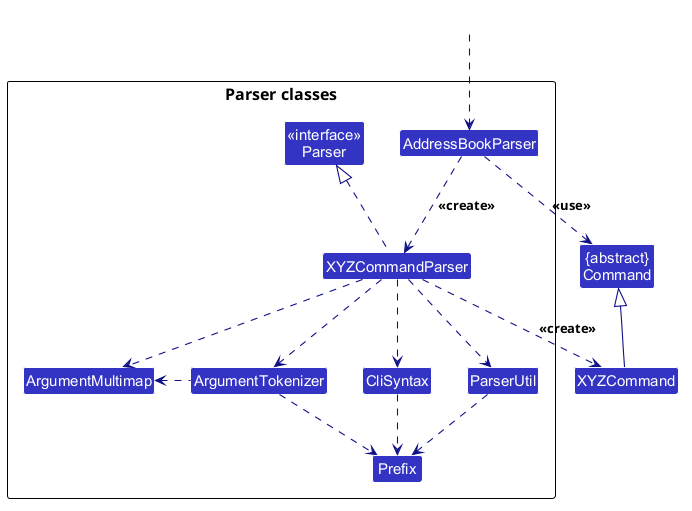

How the parsing works:
* When called upon to parse a user command, the `AddressBookParser` class creates an `XYZCommandParser` (`XYZ` is a placeholder for the specific command name, e.g., `AddStudentCommandParser`). The parser uses the other classes shown above to parse the user command and create an `XYZCommand` object (e.g., `AddStudentCommand`). The `AddressBookParser` returns that object as a `Command` object.
* All `XYZCommandParser` classes, such as `AddStudentCommandParser` and `DeleteStudentCommandParser`, implement the `Parser` interface so they can be treated similarly where appropriate, for example during testing.

### Model component
**API** : [`Model.java`](https://github.com/AY2627S1-CS2103T-F13-1/tp/tree/master/src/main/java/seedu/address/model/Model.java)

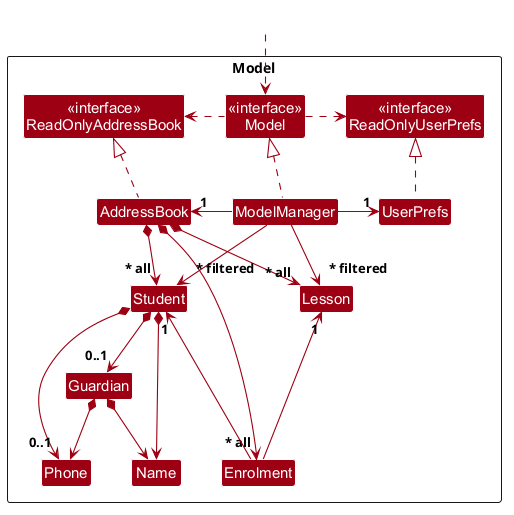

The `Model` component,

* stores all `Student`, `Lesson` and `Enrolment` objects in observable source lists owned by `AddressBook`.
* stores each student's guardian, if any, as a `Guardian` object inside that `Student`, rather than as a separate contact.
* gives every student and lesson a stable UUID. Each `Enrolment` links one student UUID to one lesson UUID, keeping `Student` and `Lesson` independent of each other.
* stores the `Student` objects selected by the current filter, such as search results or the students in one lesson, in a separate _filtered_ list. It exposes this list as an unmodifiable `ObservableList<Student>` that the UI can observe and bind to, so the UI updates when the list changes. The `Lesson` objects selected by the current filter, such as the lessons on one day, are exposed in the same way as an `ObservableList<Lesson>`.
* stores a `UserPrefs` object that represents the user’s preferences (currently, just the GUI settings). This is exposed to the outside as a `ReadOnlyUserPrefs` object.
* does not depend on any of the other three components (as the `Model` represents data entities of the domain, they should make sense on their own without depending on other components)

The diagram below shows the separate enrolment links used by the current model.

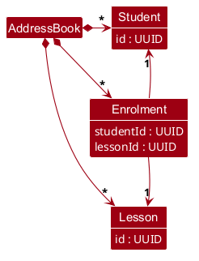

### Storage component

**API** : [`Storage.java`](https://github.com/AY2627S1-CS2103T-F13-1/tp/tree/master/src/main/java/seedu/address/storage/Storage.java)

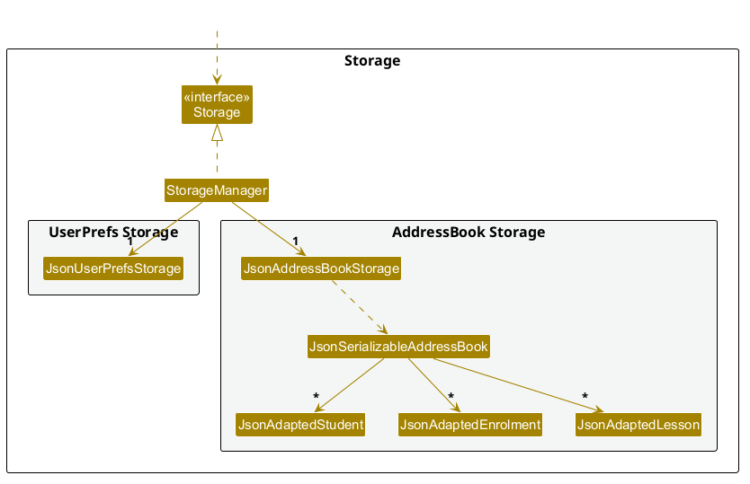

The `Storage` component stores tutor data and user preferences in separate local JSON files.
`StorageManager` delegates these operations to `JsonAddressBookStorage` and `JsonUserPrefsStorage`.
`MainApp` supplies `data/addressbook.json` for tutor data and `preferences.json` for window preferences,
both relative to the working directory from which the app is launched.

Student and lesson records retain stable UUIDs. Each enrolment stores a student UUID and a lesson UUID,
so editing contact details or lesson times does not break the relationship. Legacy `persons` records
are retained separately; they are not converted into students.

### Common classes

Classes used by multiple components are in the `seedu.address.commons` package.

--------------------------------------------------------------------------------------------------------------------

## **Implementation**

This section describes some noteworthy details on how certain features are implemented.

### Saving and recovering tutor data

#### Saving after a command

Commands change the model; they do not write files directly. `LogicManager.execute()` controls saving:

1. A command whose `changesStoredData()` returns `false` executes without checking or writing storage.
   Listing, searching, help and exit follow this path. New commands default to `true`.
1. For a potentially mutating command, the logic captures the data and display filters, then calls
   `Storage.checkAddressBookSaveAllowed()` before executing the command. A blocked path prevents execution.
1. After successful execution, the logic compares the data with the snapshot. It saves the whole address
   book only if the stored records changed; a no-op such as clearing an empty book does not write a file.
1. `StorageManager` delegates to `JsonAddressBookStorage`, which checks the path again and passes a
   `JsonSerializableAddressBook` to `JsonUtil`. The second check also protects direct storage callers.
1. `JsonUtil` serializes the data before writing, writes and flushes a temporary file in the destination
   directory, then atomically replaces the destination. If atomic replacement is unsupported, saving fails
   rather than falling back to a potentially partial overwrite. Failed writes attempt to remove the temporary file.

If the save guard or write raises an `IOException`, `LogicManager` restores the captured data and filters
and returns a `CommandException` for the existing message box. Permission failures receive a specific
message. The guard only detects paths blocked by loading failures; it cannot predict later disk-write failures.

The [save sequence diagram source](diagrams/SaveAddressBookSequenceDiagram.puml) shows the successful storage calls.

#### Loading and partial recovery

`JsonAddressBookStorage.readAddressBook()` reads the original bytes and passes the JSON to
`AddressBookRecovery`. The root must be one JSON object. Missing or null record lists are treated as empty;
a present, non-null list must be an array. Records are processed in the order `persons`, `students`,
`lessons`, then `enrolments`, so enrolment references can be checked against the recovered records.

Each record is validated independently through its JSON adapter and the model's duplicate checks.
Invalid records, duplicates and enrolments referencing missing records are skipped. The first valid
occurrence of a duplicate is retained. Skipped positions are recorded using one-based labels such as
`students[2]`; the warning log includes these labels.

| Load result | App behaviour | Protection of the original file |
| --- | --- | --- |
| File missing | Starts with sample data. | No file is written just by loading. |
| Valid file | Loads the records. | No recovery backup is needed. |
| Invalid individual records | Loads valid records and shows a skipped-record count and backup path. | Backs up the exact original bytes before returning recovered data. |
| Malformed JSON, invalid list structure, read failure or backup failure | Starts empty with a warning. Read-only commands remain available. | Blocks saving to that normalized absolute path and rejects mutating commands before execution. |

Recovery backups are stored beside the source as `<filename>.recovery-<unique suffix>.bak`. They are
not overwritten or automatically deleted, and another recovery can create another backup. Loading does
not rewrite the source: the next successful data-changing command saves the recovered records.
A recovery backup may itself contain invalid data; it is a copy for inspection and repair, not necessarily
an immediately usable restore point. Repair the file while the app is closed, then restart.

Older students without IDs receive UUIDs in memory. These IDs are written on the next successful save;
reopening an unchanged legacy file before that save generates new IDs. Lessons and enrolments require IDs.
`JsonSerializableAddressBook.toModelType()` remains a strict conversion API; normal tutor-data loading
uses `AddressBookRecovery` instead. Partial recovery applies to tutor data, not user preferences.

### Warning about clashing lessons

`addlesson` adds a lesson even if its time overlaps an existing lesson, since a tutor may teach overlapping lessons on purpose. It then warns which lessons clash, so that an accidental double-booking is noticed.

The sequence diagram below shows how `AddLessonCommand` finds the clashes before adding the lesson.

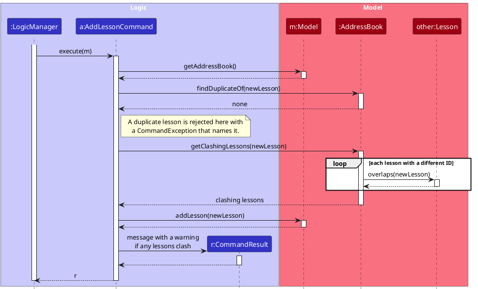

1. `AddLessonCommand#execute()` first calls `Model#hasLesson()`. A duplicate lesson is rejected with a `CommandException`, so it never gets a warning instead.
1. It calls `ReadOnlyAddressBook#getClashingLessons()`, which checks the full lesson list, so lessons hidden by `listlessons d/DAY` still count. A lesson with the same ID as the new lesson is skipped, so that a future `editlesson` does not report a lesson as clashing with its own old times.
1. `getClashingLessons()` compares each lesson with the new one using `Lesson#overlaps()`.
1. The command adds the lesson, and returns a `CommandResult` whose second line names the clashing lessons, if any.

`Lesson#overlaps()` places each lesson on a weekly cycle of 7 × 24 × 60 minutes. A lesson starts at minute `(day - 1) × 1440 + start time` and lasts `(end time - start time) mod 1440` minutes, which also gives the right length for a lesson that runs past midnight. Two lessons overlap if either one starts before the other has ended, counting forward around the week. Counting around the week lets a Sunday lesson that runs past midnight clash with an early Monday lesson. A lesson that starts exactly when another ends does not clash with it.

#### Design considerations:

**Aspect: What to do with a clashing lesson:**

* **Alternative 1 (current choice):** Add the lesson and warn.
  * Pros: Tutors who teach overlapping groups on purpose are not blocked.
  * Cons: A warning can be overlooked.

* **Alternative 2:** Reject the lesson.
  * Pros: A double-booking cannot happen by accident.
  * Cons: Overlapping lessons cannot be recorded at all, even when they are intended.

**Aspect: How to compare lessons that run past midnight:**

* **Alternative 1 (current choice):** Compare time ranges on a weekly cycle.
  * Pros: One comparison covers every case, including Sunday into Monday.
  * Cons: The modular arithmetic is less obvious than comparing two times.

* **Alternative 2:** Split a lesson that runs past midnight into one range on each day, and compare ranges on the same day.
  * Pros: Each comparison is simple.
  * Cons: A lesson may become two ranges, and Sunday into Monday still needs special handling.

### Editing students and lessons

The `editstudent` and `editlesson` commands replace immutable domain objects without changing their stable UUIDs.

1. The command parser reads a positive displayed-list index and one or more optional fields. It rejects repeated prefixes, missing edit fields and invalid values. For `editstudent`, `gn/` and `gp/` must be given together because a guardian is replaced as one value.
1. The command resolves the index against the corresponding filtered list, so it edits the item the user can see rather than the same position in the complete list.
1. The command creates a replacement object using the supplied values, the target's values for unspecified fields and the target's UUID.
1. The model rejects a replacement that would duplicate another student or lesson, then replaces the target in the source list.
1. The filtered list re-evaluates its predicate when the source item is replaced. An edited item therefore remains visible only if it still matches the active filter.

The following sequence diagram shows the successful execution of `editstudent 1 p/92345678`. The `editlesson` command follows the same sequence using its lesson-specific parser, command, filtered list and model operation.

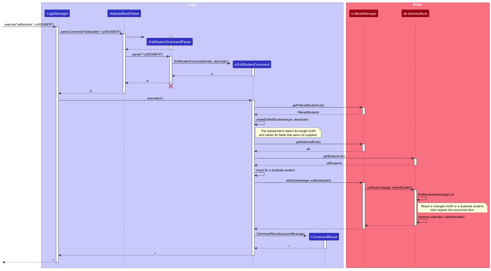

Enrolments link the stable student and lesson UUIDs. Because an edit retains the target UUID, existing enrolments continue to refer to the edited record without being recreated. This also keeps a student list filtered by lesson valid when that lesson is edited.

### Deleting a lesson

`deletelesson` deletes the lesson at a displayed index. The students in it are kept, but their enrolments in the lesson are removed, so that no enrolment refers to a missing lesson.

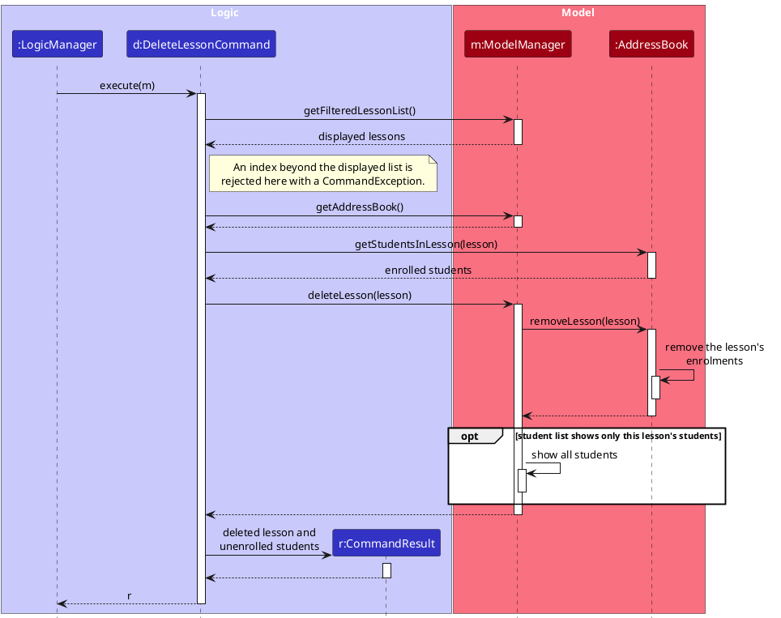

1. `DeleteLessonCommandParser` reads one positive index, and rejects anything else with the usage message.
1. `DeleteLessonCommand#execute()` looks the index up in the filtered lesson list, so it deletes the lesson the tutor sees at that position, even when `listlessons d/DAY` hides other lessons.
1. Before deleting, it asks the address book for the students enrolled in the lesson, so that the result can name them.
1. `ModelManager#deleteLesson()` calls `AddressBook#removeLesson()`, which removes the lesson's enrolments and then the lesson. If the student list shows only this lesson's students (`liststudents l/INDEX`), the model shows all students again, since that filter no longer refers to a lesson.
1. The result names the deleted lesson, marked `(next day)` if it runs past midnight, and the students who were unenrolled.

#### Design considerations:

**Aspect: What happens to the lesson's students:**

* **Alternative 1 (current choice):** Keep the students and remove only their enrolments in the lesson.
  * Pros: A tutor who stops a lesson keeps the contacts of its students and their guardians.
  * Cons: Students with no lessons left must be deleted separately if they are no longer needed.

* **Alternative 2:** Also delete students who have no other lessons.
  * Pros: No students without lessons are left behind.
  * Cons: Contacts the tutor may still need are lost without warning.

**Aspect: A student list filtered by the deleted lesson:**

* **Alternative 1 (current choice):** Show all students again.
  * Pros: The student panel never shows a filter for a lesson that no longer exists.
  * Cons: The tutor's view changes as a side effect of the deletion.

* **Alternative 2:** Keep the filter, which now matches no student.
  * Pros: The view does not change unexpectedly.
  * Cons: An empty student panel looks as if all students were deleted.

### Enrolling a student in a lesson

#### Implementation

The `enrol` command links a student to a lesson. It is facilitated by `EnrolCommand`, `EnrolCommandParser` and the following operations:

* `ReadOnlyAddressBook#isEnrolled(Student, Lesson)` — Checks whether the UUID pair already exists.
* `Model#enrolStudent(Student, Lesson)` — Adds an `Enrolment` containing the selected student and lesson UUIDs.

Given below is an example usage scenario and how the enrolment mechanism behaves at each step.

Step 1. The user executes `liststudents` and `listlessons`, so that the student and the lesson are both shown in their panels.

Step 2. The user executes `enrol s/1 l/2`. `EnrolCommandParser` checks that both `s/` and `l/` are present exactly once and that each value is a positive integer, then creates an `EnrolCommand` with the two indices.

Step 3. `EnrolCommand#execute()` looks up the 1st student in the filtered student list and the 2nd lesson in the filtered lesson list. If either index is out of range, it throws a `CommandException`, checking the student index first.

Step 4. The command calls `ReadOnlyAddressBook#isEnrolled()`. If the UUID pair already exists, it throws a `CommandException` naming both the student and the lesson.

Step 5. Otherwise, the command calls `Model#enrolStudent()`, which adds a new `Enrolment` to the source list. Both panels update because they derive each student's lessons and each lesson's students from that list.

Deleting a student or lesson also removes every enrolment containing that record's UUID.

#### Design considerations:

**Aspect: Where enrolments are stored:**

* **Alternative 1:** Each `Student` holds the set of `Lesson` objects they are enrolled in.
  * Pros: Showing a student's lessons is direct, and saving follows the same pattern as other fields of `Student`.
  * Cons: Showing a lesson's students requires checking every student. Deleting a lesson requires updating every student enrolled in it.

* **Alternative 2:** Each `Lesson` holds the set of `Student` objects enrolled in it.
  * Pros: Showing a lesson's students is direct.
  * Cons: Editing or deleting a student requires updating every lesson they are in, and the relationship is owned asymmetrically.

* **Alternative 3 (current choice):** A separate list of `Enrolment` objects, each linking one student UUID to one lesson UUID.
  * Pros: `Student` and `Lesson` stay independent, edits preserve links through stable UUIDs, and enrolments have one authoritative representation.
  * Cons: Looking up either side of the relationship requires searching the enrolment list.

### Unenrolling a student from a lesson

The `unenrol` command removes a student from a lesson, keeping both the student and the lesson. It is facilitated by `UnenrolCommand`, `UnenrolCommandParser` and the following operations:

* `ReadOnlyAddressBook#isEnrolled(Student, Lesson)` — Checks whether the student is enrolled in the lesson.
* `Model#unenrolStudent(Student, Lesson)` — Removes the enrolment linking the student to the lesson.

The sequence diagram below shows how `unenrol s/1 l/2` is executed.

:information_source: **Note:** The lifeline for `UnenrolCommandParser` should end at the destroy marker (X), but due to a limitation of PlantUML, it continues to the end of the diagram.

Step 1. `UnenrolCommandParser` checks that `s/` and `l/` are each present exactly once, that there is no other text before them, and that each value is a positive integer. It then creates an `UnenrolCommand` with the two indices.

Step 2. `UnenrolCommand#execute()` looks up the student in the filtered student list and the lesson in the filtered lesson list. If either index is out of range, it throws a `CommandException`, checking the student index first.

Step 3. The command calls `ReadOnlyAddressBook#isEnrolled()`. If the student is not enrolled in the lesson, it throws a `CommandException` naming both the student and the lesson.

Step 4. Otherwise, the command calls `Model#unenrolStudent()`, which removes the enrolment from the `AddressBook`. If the student list is currently showing only one lesson's students, the filter is reapplied, so a student unenrolled from that lesson disappears from the list. Both panels stay filtered as before.

### \[Proposed\] Undo/redo feature

#### Proposed Implementation

The proposed undo/redo mechanism is facilitated by `VersionedAddressBook`. It extends `AddressBook` with an undo/redo history, stored internally as a `addressBookStateList` and `currentStatePointer`. Additionally, it implements the following operations:

* `VersionedAddressBook#commit()` — Saves the current address book state in its history.
* `VersionedAddressBook#undo()` — Restores the previous address book state from its history.
* `VersionedAddressBook#redo()` — Restores a previously undone address book state from its history.

These operations are exposed in the `Model` interface as `Model#commitAddressBook()`, `Model#undoAddressBook()` and `Model#redoAddressBook()` respectively.

Given below is an example usage scenario and how the undo/redo mechanism behaves at each step.

Step 1. The user launches the application for the first time. The `VersionedAddressBook` will be initialized with the initial address book state, and the `currentStatePointer` pointing to that single address book state.

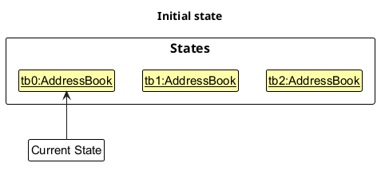

Step 2. The user executes `deletestudent 5` command to delete the 5th student in the address book. The `deletestudent` command calls `Model#commitAddressBook()`, causing the modified state of the address book after the `deletestudent 5` command executes to be saved in the `addressBookStateList`, and the `currentStatePointer` is shifted to the newly inserted address book state.

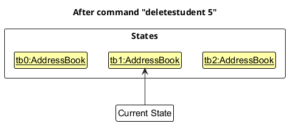

Step 3. The user executes `addstudent n/David …​` to add a new student. The `addstudent` command also calls `Model#commitAddressBook()`, causing another modified address book state to be saved into the `addressBookStateList`.

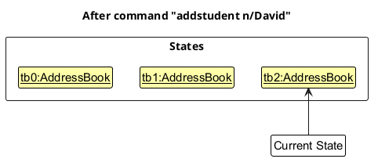

:information_source: **Note:** If a command fails its execution, it will not call `Model#commitAddressBook()`, so the address book state will not be saved into the `addressBookStateList`.

Step 4. The user now decides that adding the student was a mistake, and decides to undo that action by executing the `undo` command. The `undo` command will call `Model#undoAddressBook()`, which will shift the `currentStatePointer` once to the left, pointing it to the previous address book state, and restores the address book to that state.

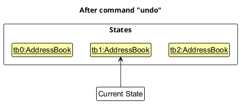

:information_source: **Note:** If the `currentStatePointer` is at index 0, pointing to the initial address book state, then there are no previous address book states to restore. The `undo` command uses `Model#canUndoAddressBook()` to check if this is the case. If so, it will return an error to the user rather
than attempting to perform the undo.

The following sequence diagram shows how an undo operation goes through the `Logic` component:

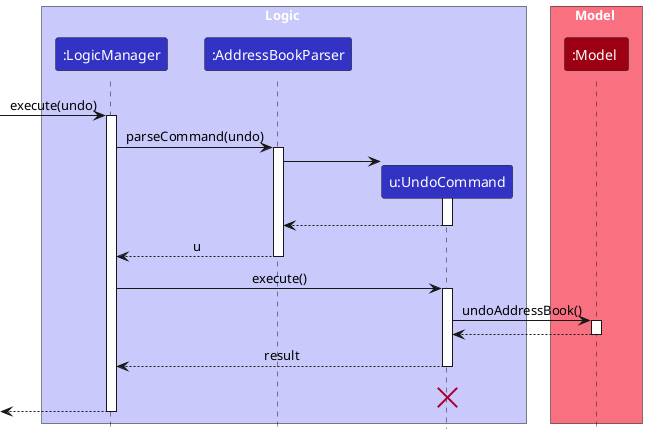

:information_source: **Note:** The lifeline for `UndoCommand` should end at the destroy marker (X), but due to a limitation of PlantUML, it continues to the end of the diagram.

Similarly, how an undo operation goes through the `Model` component is shown below:

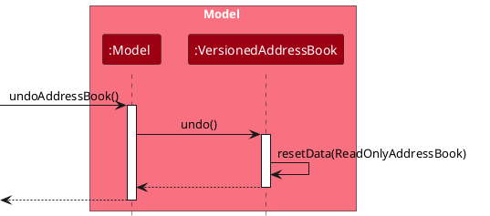

The `redo` command does the opposite — it calls `Model#redoAddressBook()`, which shifts the `currentStatePointer` once to the right, pointing to the previously undone state, and restores the address book to that state.

:information_source: **Note:** If the `currentStatePointer` is at index `addressBookStateList.size() - 1`, pointing to the latest address book state, then there are no undone address book states to restore. The `redo` command uses `Model#canRedoAddressBook()` to check if this is the case. If so, it will return an error to the user rather than attempting to perform the redo.

Step 5. The user then decides to execute the command `liststudents`. Commands that do not modify the address book, such as `liststudents`, will usually not call `Model#commitAddressBook()`, `Model#undoAddressBook()` or `Model#redoAddressBook()`. Thus, the `addressBookStateList` remains unchanged.

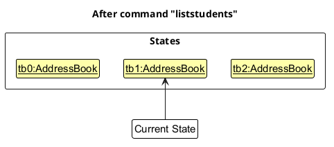

Step 6. The user executes `addlesson n/Sec 1 Math …​`, which calls `Model#commitAddressBook()`. Since the `currentStatePointer` is not pointing at the end of the `addressBookStateList`, all address book states after the `currentStatePointer` will be purged. Reason: It no longer makes sense to redo the `addstudent n/David …​` command. This is the behavior that most modern desktop applications follow.

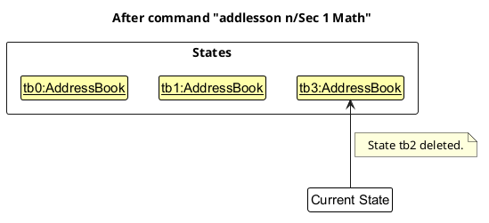

The following activity diagram summarizes what happens when a user executes a new command:

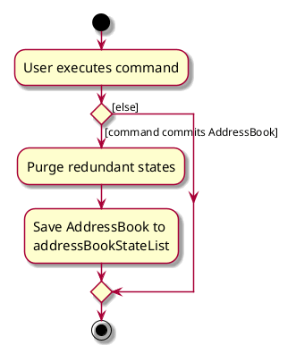

#### Design considerations:

**Aspect: How undo & redo execute:**

* **Alternative 1 (current choice):** Saves the entire address book.
  * Pros: Easy to implement.
  * Cons: May have performance issues in terms of memory usage.

* **Alternative 2:** Individual command knows how to undo/redo by
  itself.
  * Pros: Will use less memory (e.g. for `deletestudent`, just save the student being deleted).
  * Cons: We must ensure that the implementation of each individual command is correct. Commands with side effects, such as `deletelesson` removing the lesson from every enrolled student, are harder to reverse correctly.

--------------------------------------------------------------------------------------------------------------------

## **Documentation, logging, testing, dev-ops**

* [Documentation guide](Documentation.md)
* [Testing guide](Testing.md)
* [Logging guide](Logging.md)
* [DevOps guide](DevOps.md)

--------------------------------------------------------------------------------------------------------------------

## **Appendix: Requirements**

### Product scope

**Target user profile**:

* is an independent private tutor who teaches secondary-school students
* has to keep track of many students, along with their parents' or guardians' contact details
* teaches several weekly lessons, each with a different group of students
* often needs to contact a student or their guardian quickly
* prefers desktop apps over other types of applications
* can type fast and prefers typing to mouse interactions
* is reasonably comfortable using CLI apps

**Value proposition**: Help independent private tutors organise and quickly retrieve student and guardian contact details, reducing the effort needed to manage multiple students and communicate with the right family.

### User stories

Priorities: High (must have) - `* * *`, Medium (nice to have) - `* *`, Low (unlikely to have) - `*`

| Priority | As a …​                                   | I want to …​                                                     | So that I can…​                                                                  |
|----------|-------------------------------------------|------------------------------------------------------------------|----------------------------------------------------------------------------------|
| `* * *`  | new user                                  | see usage instructions                                           | refer to instructions when I forget how to use the app                           |
| `* * *`  | tutor                                     | add a student with their contact details                         | start storing my students' contact details                                       |
| `* * *`  | tutor                                     | add a guardian's contact details to a student                    | reach the student's family when the student has no phone of their own            |
| `* * *`  | tutor                                     | see at a glance which details belong to a student and which to a guardian | tell whom I am calling before I call                                    |
| `* * *`  | tutor                                     | delete a student                                                 | remove students who have stopped lessons                                         |
| `* * *`  | tutor                                     | view all my students with their contact details                  | see what information I have stored                                               |
| `* * *`  | tutor                                     | find a student by name                                           | retrieve their contact details without browsing the entire list                  |
| `* * *`  | tutor                                     | find students by their guardian's name                           | tell which student a guardian's message is about                                 |
| `* * *`  | tutor                                     | find a student by part of a phone number                         | tell who is contacting me from a number I have not saved                         |
| `* * *`  | tutor                                     | add a weekly lesson with its day and time                        | organise my students by the lessons they attend                                  |
| `* * *`  | tutor                                     | delete a lesson                                                  | remove lessons that no longer run                                                |
| `* * *`  | tutor                                     | view all my lessons and the students in each                     | see how my students are organised                                                |
| `* * *`  | tutor                                     | enrol a student in a lesson                                      | keep track of which students attend which lesson                                 |
| `* * *`  | tutor                                     | view the students in a particular lesson                         | contact the families relevant to that lesson                                     |
| `* * *`  | tutor                                     | have my data saved automatically                                 | keep my records without having to save them manually                             |
| `* *`    | tutor                                     | view only the lessons on a particular day                        | focus on the lessons I teach that day                                            |
| `* *`    | tutor                                     | remove a student from a lesson                                   | correct a wrong enrolment or record a student leaving one lesson                 |
| `* *`    | tutor                                     | edit a student's or guardian's details                           | correct inaccurate or outdated details                                           |
| `* *`    | tutor                                     | edit a lesson's details                                          | update a lesson that has moved to a different day or time                        |
| `* *`    | tutor                                     | undo my most recent change                                       | recover from an accidental addition, edit or deletion                            |
| `* *`    | tutor                                     | add more than one guardian to a student                          | store the contact details of both parents                                        |
| `* *`    | tutor of a student with several guardians | mark one guardian as the primary contact                         | know whom to contact first                                                       |
| `* *`    | tutor                                     | copy a phone number or email address                             | paste it into my preferred messaging app                                         |
| `* *`    | tutor                                     | record a contact's email address                                 | reach families who prefer email                                                  |
| `* *`    | tutor                                     | record a contact's preferred communication method                | reach them in the way they prefer                                                |
| `* *`    | home tutor                                | record a student's lesson location                               | remember where each student's lessons are held                                   |
| `* *`    | tutor who teaches several subjects        | record the subject I teach each student                          | avoid confusing students with similar names or in similar lessons                |
| `* *`    | expert user                               | filter students using several criteria at once                   | quickly narrow down a long list of students                                      |
| `* *`    | expert user                               | enrol or remove several students in one command                  | manage enrolment changes efficiently                                             |
| `*`      | detail-oriented tutor                     | add private notes to a student                                   | record useful information that does not belong in their contact details          |
| `*`      | tutor                                     | be warned when a new lesson clashes with an existing one         | avoid double-booking myself                                                      |
| `*`      | tutor                                     | archive students who have stopped lessons                        | keep their details for future reference without cluttering my list              |

### Use cases

(For all use cases below, the **System** is `TutorReach` and the **Actor** is the `tutor`, unless specified otherwise)

**Use case: UC01 - Add a student**

**MSS**

1.  Tutor requests to add a student, giving the student's name and at least one phone number (the student's, or a guardian's name and phone number).
2.  TutorReach adds the student and shows the added student's details.

    Use case ends.

**Extensions**

* 1a. A required detail is missing, or a guardian's name is given without a phone number (or vice versa).

    * 1a1. TutorReach shows an error message.

      Use case resumes at step 1.

* 1b. A given detail is invalid.

    * 1b1. TutorReach shows an error message.

      Use case resumes at step 1.

* 1c. The student already exists in TutorReach.

    * 1c1. TutorReach shows an error message.

      Use case ends.

**Use case: UC02 - Delete a student**

**MSS**

1.  Tutor requests to list students.
2.  TutorReach shows a list of students.
3.  Tutor requests to delete a specific student in the list.
4.  TutorReach deletes the student, removes them from all their lessons, and shows the deleted student's details.

    Use case ends.

**Extensions**

* 1a. Tutor requests to find students by name instead (UC05).

  Use case resumes at step 2.

* 2a. The list is empty.

  Use case ends.

* 3a. The given index is invalid.

    * 3a1. TutorReach shows an error message.

      Use case resumes at step 2.

**Use case: UC03 - Add a lesson**

**MSS**

1.  Tutor requests to add a lesson, giving its name, day, start time and end time.
2.  TutorReach adds the lesson and shows the added lesson's details.

    Use case ends.

**Extensions**

* 1a. A required detail is missing.

    * 1a1. TutorReach shows an error message.

      Use case resumes at step 1.

* 1b. A given detail is invalid, or the end time is the same as the start time.

    * 1b1. TutorReach shows an error message.

      Use case resumes at step 1.

* 1c. A lesson with the same name, day, start time and end time already exists.

    * 1c1. TutorReach shows an error message.

      Use case ends.

* 1d. The lesson's time overlaps an existing lesson.

    * 1d1. TutorReach adds the lesson and warns which lessons it clashes with.

      Use case ends.

**Use case: UC04 - Enrol a student in a lesson**

**MSS**

1.  Tutor requests to list students.
2.  TutorReach shows a list of students.
3.  Tutor requests to list lessons.
4.  TutorReach shows a list of lessons.
5.  Tutor requests to enrol a specific student in the student list in a specific lesson in the lesson list.
6.  TutorReach enrols the student in the lesson and shows the student's and lesson's names.

    Use case ends.

**Extensions**

* 1a. Tutor requests to find students by name instead (UC05).

  Use case resumes at step 2.

* 2a. The list of students is empty.

  Use case ends.

* 4a. The list of lessons is empty.

    * 4a1. Tutor adds a lesson (UC03).

      Use case resumes at step 3.

* 5a. The given student index or lesson index is invalid.

    * 5a1. TutorReach shows an error message.

      Use case resumes at step 5.

* 5b. The student is already enrolled in the lesson.

    * 5b1. TutorReach shows an error message.

      Use case ends.

**Use case: UC05 - Find a student by name**

**MSS**

1.  Tutor requests to find students whose names contain the given keywords.
2.  TutorReach shows the matching students with their own and their guardians' contact details.

    Use case ends.

**Extensions**

* 1a. Tutor gives keywords for the guardian's name instead of, or as well as, the student's name.

  Use case resumes at step 2, with TutorReach matching students against all the given keywords.

* 1b. Tutor gives part of a phone number instead of, or as well as, names.

  Use case resumes at step 2, with TutorReach matching students whose own or guardian's phone number contains it.

* 1c. No keywords are given, or a phone keyword contains a character other than a digit.

    * 1c1. TutorReach shows an error message.

      Use case resumes at step 1.

* 2a. No student matches the keywords.

  Use case ends.

**Use case: UC06 - Contact the families of students in a lesson**

**MSS**

1.  Tutor requests to list the lessons on a particular day.
2.  TutorReach shows the lessons on that day.
3.  Tutor requests to list the students in a specific lesson in the list.
4.  TutorReach shows the students in that lesson with their own and their guardians' contact details.
5.  Tutor contacts the families using the contact details shown.

    Use case ends.

**Extensions**

* 1a. The given day is invalid.

    * 1a1. TutorReach shows an error message.

      Use case resumes at step 1.

* 2a. There are no lessons on that day.

  Use case ends.

* 3a. The given index is invalid.

    * 3a1. TutorReach shows an error message.

      Use case resumes at step 2.

* 4a. No students are enrolled in the lesson.

  Use case ends.

**Use case: UC07 - Delete a lesson**

**MSS**

1.  Tutor requests to list lessons.
2.  TutorReach shows a list of lessons.
3.  Tutor requests to delete a specific lesson in the list.
4.  TutorReach deletes the lesson, removes it from its students' records, and shows the deleted lesson's details and the students who were unenrolled.

    Use case ends.

**Extensions**

* 2a. The list is empty.

  Use case ends.

* 3a. The given index is invalid.

    * 3a1. TutorReach shows an error message.

      Use case resumes at step 2.

**Use case: UC08 - Edit a student**

**MSS**

1.  Tutor requests to list or find students.
1.  TutorReach shows the matching students.
1.  Tutor requests to edit one or more details of a specific student in the displayed list.
1.  TutorReach updates the student, preserves the student's enrolments and shows the edited student's details.

    Use case ends.

**Extensions**

* 2a. The list is empty.

  Use case ends.

* 3a. The given index is invalid, no edit field is given or a given detail is invalid.

    * 3a1. TutorReach shows an error message.

      Use case resumes at step 3.

* 3b. Only one of the guardian's name and phone number is given.

    * 3b1. TutorReach shows an error message.

      Use case resumes at step 3.

* 3c. The edited details would duplicate another student.

    * 3c1. TutorReach shows an error message.

      Use case ends.

* 4a. The edited student no longer matches the active student filter.

  TutorReach removes the student from the displayed list after completing the edit.

**Use case: UC09 - Edit a lesson**

**MSS**

1.  Tutor requests to list lessons.
1.  TutorReach shows the matching lessons.
1.  Tutor requests to edit one or more details of a specific lesson in the displayed list.
1.  TutorReach updates the lesson, preserves its student enrolments and shows the edited lesson's details.

    Use case ends.

**Extensions**

* 2a. The list is empty.

  Use case ends.

* 3a. The given index is invalid, no edit field is given or a given detail is invalid.

    * 3a1. TutorReach shows an error message.

      Use case resumes at step 3.

* 3b. The edited start and end times are the same.

    * 3b1. TutorReach shows an error message.

      Use case resumes at step 3.

* 3c. The edited details would duplicate another lesson.

    * 3c1. TutorReach shows an error message.

      Use case ends.

* 4a. The edited lesson no longer matches the active lesson filter.

  TutorReach removes the lesson from the displayed list after completing the edit.

### Non-Functional Requirements

1.  Should work on any _mainstream OS_ as long as it has Java `25` or above installed.
2.  A user with above average typing speed for regular English text (i.e. not code, not system admin commands) should be able to accomplish most of the tasks faster using commands than using the mouse.
3.  Should work without an internet connection.
4.  Should save the data after every command that changes it, so that no data is lost if the app is closed or the computer shuts down unexpectedly after that command.
5.  Should store the data locally in a human-editable text file, so that advanced users can edit or back up the data directly.
6.  Should not send any student or guardian data off the user's computer.
7.  Should run from a single JAR file without an installer, and the JAR file should not exceed 100MB.
8.  Should be used by a single user on one computer; it does not need to support sharing data between users.
9.  The GUI should work well (i.e., no resizing needed to use all features) for screen resolutions of 1920x1080 and higher at screen scales of 100% and 125%, and be usable (i.e., all features can be used, even if not optimally) at 1280x720 and higher at a screen scale of 150%.

### Glossary

* **Mainstream OS**: Windows, Linux, Unix, or macOS
* **Tutor**: The user of TutorReach; an independent private tutor
* **Student**: A person the tutor teaches; stored with their name, an optional phone number and an optional guardian
* **Guardian**: A parent or other adult responsible for a student, stored as part of that student's record with a name and phone number
* **Lesson**: A weekly time slot in which the tutor teaches a group of students, identified by its name, day, start time and end time. A lesson whose end time is earlier than its start time runs past midnight; its day is the day it starts on
* **Enrol**: To link a student to a lesson, recording that the student attends that lesson
* **Index**: The number shown next to a student or lesson in the currently displayed list, used in commands to refer to that student or lesson
* **Duplicate student**: A student whose name matches an existing student's (ignoring case and extra spaces) and who shares at least one phone number with them, counting both student and guardian phone numbers
* **Duplicate lesson**: A lesson whose name (ignoring case and extra spaces), day, start time and end time all match an existing lesson's

--------------------------------------------------------------------------------------------------------------------

## **Appendix: Instructions for manual testing**

Given below are instructions to test the app manually.

:information_source: **Note:** These instructions only provide a starting point for testers to work on;
testers are expected to do more *exploratory* testing.

### Launch and shutdown

1. Initial launch

   1. Download the JAR file and copy it into an empty folder.

   1. Double-click the JAR file. 
      Expected: The GUI opens with a set of sample students and lessons. The window size may not be optimal.

1. Saving window preferences

   1. Resize the window to an optimal size. Move the window to a different location. Close the window.

   1. Relaunch the app by double-clicking the JAR file. 
       Expected: The most recent window size and location are retained.

1. Shutting down

   1. Test case: `exit` 
      Expected: The app closes.

### Adding a student

1. Adding a student while all students are being shown

   1. Prerequisites: List all students using the `liststudents` command.

   1. Test case: `addstudent n/Aiden Tan gn/Tan Mei Ling gp/91234567` 
      Expected: A student card for Aiden Tan is added at the end of the students panel, with no phone of their own and Tan Mei Ling as guardian. The status message shows the added student's details.

   1. Test case: `addstudent n/Ryan Lim p/93210283` 
      Expected: A student with no guardian is added. The status message shows the added student's details.

   1. Test case: `addstudent n/Ryan Lim` 
      Expected: No student is added. The status message states that at least one phone number is required.

   1. Test case: `addstudent n/Ryan Lim gn/Lim Wei` 
      Expected: No student is added. The status message states that guardian name and guardian phone must be given together.

1. Adding a duplicate student

   1. Prerequisites: The test case `addstudent n/Aiden Tan gn/Tan Mei Ling gp/91234567` above has been executed.

   1. Test case: `addstudent n/aiden  tan p/91234567` 
      Expected: No student is added, since the name matches (ignoring case and extra spaces) and a phone number is shared. The status message shows `This student already exists`.

   1. Test case: `addstudent n/Aiden Tan p/88887777` 
      Expected: The student is added, since no phone number is shared.

### Editing a student

1. Editing a student while all students are shown

   1. Prerequisites: List all students using `liststudents`. The first student has a guardian and is enrolled in at least one lesson.

   1. Test case: `editstudent 1 p/92345678` 
      Expected: Only the first student's phone number changes. Their name, guardian and lesson enrolments remain unchanged, and the status message shows the edited student's details.

   1. Test case: `editstudent 1 gn/Lim Mei gp/91234567` 
      Expected: Only the first student's guardian details are replaced. Their own details and lesson enrolments remain unchanged.

   1. Test case: `editstudent 1 gn/Lim Mei` 
      Expected: No student is edited. The status message states that guardian name and guardian phone must be given together.

   1. Other incorrect commands to try: `editstudent 1`, `editstudent 0 n/Aiden`, `editstudent 1 p/12`, `editstudent 1 n/Aiden n/Ryan` 
      Expected: No student is edited. The status message shows the relevant missing field, invalid index, invalid phone or duplicate-prefix error.

1. Editing a student while the students panel is filtered

   1. Prerequisites: Execute `findstudent n/aiden`, with Aiden shown as the first result.

   1. Test case: `editstudent 1 n/Zoe Tan` 
      Expected: The student is edited and disappears from the displayed list because the active search filter is re-evaluated.

   1. Prerequisites: List the students in a lesson using `liststudents l/1`, with at least one student shown.

   1. Test case: `editstudent 1 p/93456789` 
      Expected: The first displayed student is edited and remains in the list because the lesson enrolment is preserved.

### Deleting a student

1. Deleting a student while all students are being shown

   1. Prerequisites: List all students using the `liststudents` command, with multiple students in the list.

   1. Test case: `deletestudent 1` 
      Expected: The first student is deleted from the list and removed from every lesson card. The status message shows the deleted student's details.

   1. Test case: `deletestudent 0` 
      Expected: No student is deleted. The status message shows the invalid command format error.

   1. Other incorrect delete commands to try: `deletestudent`, `deletestudent abc`, `deletestudent 1 2`, `deletestudent x` (where x is larger than the list size) 
      Expected: Similar to previous.

1. Deleting a student while the students panel is filtered

   1. Prerequisites: Show only some students, e.g. using `findstudent n/tan`.

   1. Test case: `deletestudent 1` 
      Expected: The first student shown is deleted. The filter stays on.

### Adding and deleting a lesson

1. Adding a lesson

   1. Test case: `addlesson n/Sec 3 A-Math d/mon st/1600 et/1800` 
      Expected: A lesson card for Sec 3 A-Math (Mon 1600-1800) with no students is added at the end of the lessons panel.

   1. Test case: the same command again 
      Expected: No lesson is added. The status message shows `This lesson already exists.`

   1. Test case: `addlesson n/sec 3  a-math d/MON st/1600 et/1800` 
      Expected: No lesson is added. The day may be in any letter case, and the name matches the existing lesson's once case and extra spaces are ignored. The status message shows `This lesson already exists.`

   1. Test case: `addlesson n/Night Class d/fri st/2200 et/0100` 
      Expected: A lesson card for Night Class (Fri 2200-0100) is added. An end time earlier than the start time means the lesson runs past midnight and ends on the next day, so the status message marks it `(next day)`.

   1. Test case: `addlesson n/Sec 3 A-Math d/mon st/1600 et/1600` 
      Expected: No lesson is added. The status message states that the end time must not be the same as the start time.

   1. Other incorrect commands to try: `addlesson n/Math d/tues st/1600 et/1800`, `addlesson n/Math d/monday st/1600 et/1800`, `addlesson n/Math d/mon st/4pm et/1800`, `addlesson n/Math d/mon st/2400 et/2430` 
      Expected: No lesson is added. The status message shows the error for the invalid value: a day must be one of `mon`, `tue`, `wed`, `thu`, `fri`, `sat` and `sun`, and a time must be exactly four digits from `0000` to `2359`.

1. Adding a lesson that clashes with another

   1. Prerequisites: The lesson Sec 3 A-Math (Mon 1600-1800) exists, and no other lesson is on Monday evening.

   1. Test case: `addlesson n/Sec 3 E-Math d/mon st/1700 et/1900` 
      Expected: The lesson is added. The status message shows the added lesson and, on the next line, a warning that it clashes with Sec 3 A-Math (Mon 1600-1800).

   1. Test case: `addlesson n/Sec 2 Math d/mon st/1900 et/2000` 
      Expected: The lesson is added with no warning, since it starts exactly when Sec 3 E-Math ends.

1. Filtering lessons by day

   1. Prerequisites: Add lessons on at least two different days, including Monday.

   1. Test case: `listlessons d/mon` 
      Expected: Only lessons starting on Monday are shown. Matching is case-insensitive.

   1. Test case: `listlessons` 
      Expected: All lessons are shown again.

   1. Other incorrect commands to try: `listlessons mon`, `listlessons d/monday`, `listlessons d/mon d/tue`, `listlessons n/Math` 
      Expected: The list is unchanged. The status message shows the relevant invalid command, day or duplicate-prefix error.

1. Deleting a lesson

   1. Prerequisites: List all lessons using `listlessons`. The first lesson has at least one student enrolled.

   1. Test case: `deletelesson 1` 
      Expected: The first lesson is deleted. Its enrolled students are kept, but the lesson is removed from their cards. The status message lists the students who were unenrolled.

   1. Test case: `deletelesson 0` 
      Expected: No lesson is deleted. The status message shows the invalid command format error.

   1. Other incorrect delete commands to try: `deletelesson`, `deletelesson abc`, `deletelesson 1 2` 
      Expected: Similar to previous.

   1. Test case: `deletelesson x` (where x is larger than the number of lessons shown) 
      Expected: No lesson is deleted. The status message shows `The lesson index provided is invalid.`

### Editing a lesson

1. Editing a lesson while all lessons are shown

   1. Prerequisites: List all lessons using `listlessons`. The first lesson has at least one enrolled student.

   1. Test case: `editlesson 1 d/tue` 
      Expected: Only the first lesson's day changes. Its name, times and student enrolments remain unchanged, and the status message shows the edited lesson's details.

   1. Test case: `editlesson 1 st/2200 et/0100` 
      Expected: The lesson is edited to run past midnight and retains its student enrolments.

   1. Test case: `editlesson 1 st/1700 et/1700` 
      Expected: No lesson is edited. The status message states that the end time must not be the same as the start time.

   1. Other incorrect commands to try: `editlesson 1`, `editlesson 0 n/Math`, `editlesson 1 d/monday`, `editlesson 1 st/4pm`, `editlesson 1 d/mon d/tue` 
      Expected: No lesson is edited. The status message shows the relevant missing field, invalid index, invalid value or duplicate-prefix error.

1. Editing a lesson while a filter is active

   1. Prerequisites: Show Monday lessons using `listlessons d/mon`, with at least one lesson shown.

   1. Test case: `editlesson 1 d/tue` 
      Expected: The lesson is edited and disappears from the displayed lesson list because the active day filter is re-evaluated.

   1. Prerequisites: Run `listlessons` to show all lessons, then list students in the first lesson using `liststudents l/1`, with at least one student shown.

   1. Test case: `editlesson 1 n/Updated Mathematics` 
      Expected: The lesson is edited, and the filtered student list remains unchanged because the lesson's identity and enrolments are preserved.

### Enrolling a student in a lesson

1. Enrolling a student

   1. Prerequisites: List all students and lessons using `liststudents` and `listlessons`, with at least one of each. The first student is not enrolled in the first lesson.

   1. Test case: `enrol s/1 l/1` 
      Expected: The lesson appears on the first student's card, and the student appears on the first lesson's card.

   1. Test case: `enrol s/1 l/1` again 
      Expected: No change. The status message states that the student is already enrolled in the lesson.

   1. Test case: `enrol 1 1` 
      Expected: No change. The status message shows the invalid command format error.

   1. Test case: `enrol s/x l/1` (where x is larger than the number of students shown) 
      Expected: No change. The status message shows `The student index provided is invalid`.

### Viewing and finding students

1. Viewing the students in a lesson

   1. Prerequisites: At least one lesson is shown, with students enrolled.

   1. Test case: `liststudents l/1` 
      Expected: Only the students enrolled in the first lesson are shown, and the status message states how many.

   1. Test case: `liststudents 1` 
      Expected: The list is unchanged. The status message shows the invalid command format error.

   1. Test case: `liststudents` 
      Expected: All students are shown again.

1. Deleting the lesson used to filter students

   1. Prerequisites: At least two students and one lesson are shown. Enrol only the first student in the first lesson, then execute `liststudents l/1`.

   1. Test case: `deletelesson 1` 
      Expected: The selected lesson is deleted and all remaining students are shown again, because the lesson used by the student filter no longer exists.

1. Finding students

   1. Test case: `findstudent gn/tan` 
      Expected: Only students whose guardian's name contains "tan" are shown.

   1. Test case: `findstudent n/` 
      Expected: The list is unchanged. The status message states that the search text cannot be empty.

   1. Test case: `findstudent p/9123` 
      Expected: Only students whose own phone number or guardian's phone number contains "9123" are shown.

   1. Test case: `findstudent p/91a` 
      Expected: The list is unchanged. The status message states that phone search keywords should only contain digits.

### Saving data

Use a disposable copy of the data file for these tests. The default path is `data/addressbook.json`
relative to the app's working directory. Close the app before
editing files, and retain a separate copy of the original data.

1. Missing file: move the data file aside and launch the app. Expect sample students and lessons.
   Exit without changing data; no tutor data file should be created.
1. Partial recovery: in a valid file containing at least two students, change one student's phone to
   `invalid`, then restart. Expect that student and any enrolments referencing them to be skipped,
   valid records to remain, and a warning containing the backup path. Check that the backup contains
   the original invalid value. Listing and exiting must leave the source file unchanged.
1. Saving recovered data: repeat the partial-recovery setup, then successfully add a new student.
   Restart and verify that the recovered records and new student persist. The recovery backup must remain.
1. Unrecoverable file: remove a closing `}` and restart. Expect an empty app and a warning that saving
   is disabled. `liststudents`, `help` and `exit` must work. An `addstudent` command must report an error
   without adding a student or changing the file. Restore the valid copy and restart to resume normal use.
1. Save failure: with valid data loaded, make the destination unwritable using filesystem permissions
   supported by your OS, then try adding a student. Expect a save error, unchanged stored data and
   restoration of the previous displayed lists. Restore permissions before retrying.
