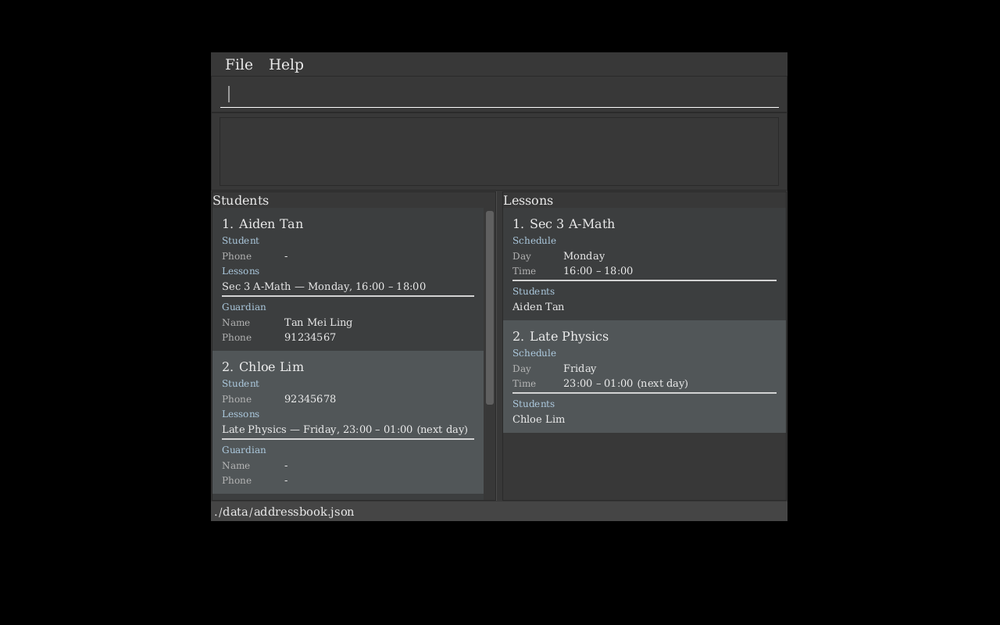
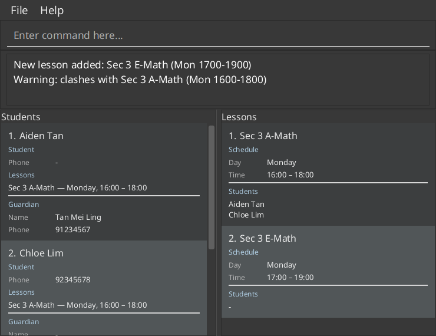

TutorReach is a **desktop app for independent private tutors who teach secondary-school students, optimized for use through a Command Line Interface (CLI)** while retaining the benefits of a Graphical User Interface (GUI). It keeps your students' and their guardians' contact details in one place, grouped by the weekly lessons you teach. If you type quickly, TutorReach can help you manage them faster than traditional GUI applications.

* Table of Contents
{:toc}

--------------------------------------------------------------------------------------------------------------------

## Quick start

1. Ensure that Java `25` or later is installed on your computer. 
   **Mac users:** Ensure you have the precise JDK version prescribed [here](https://se-education.org/guides/tutorials/javaInstallationMac.html).

1. Download the latest `.jar` file from [here](https://github.com/AY2627S1-CS2103T-F13-1/tp/releases).

1. Copy the file to the folder you want to use as the _home folder_ for TutorReach.

1. Open a terminal, `cd` to the folder containing the JAR file, and run `java -jar addressbook.jar`. 
   A GUI similar to the one below should appear in a few seconds. Note how the app contains some sample data. 
   

1. Type a command in the command box and press Enter to execute it. For example, type **`help`** and press Enter to open the help window. 
   Some example commands you can try:

   * `addstudent n/Ben Koh gn/Koh Siew Lan gp/98765432` : Adds a student named `Ben Koh` with a guardian.

   * `addlesson n/Sec 3 A-Math d/mon st/1600 et/1800` : Adds a weekly Monday lesson from 4:00 PM to 6:00 PM.

   * `liststudents` : Lists all students.

   * `deletestudent 3` : Deletes the 3rd student shown in the current list.

   * `clear` : Shows how to confirm deletion of all students and lessons.

   * `exit` : Exits the app.

1. Refer to the [Features](#features) section below for details of each command.

--------------------------------------------------------------------------------------------------------------------

## Features

**:information_source: Notes about the command format:** 

* Words in `UPPER_CASE` are the parameters to be supplied by the user. 
  For example, in `addstudent n/NAME`, replace `NAME` with a value such as `Aiden Tan`.

* Items in square brackets are optional. 
  For example, `listlessons [d/DAY]` can be used as `listlessons` or as `listlessons d/mon`.

* Items followed by `...` take one or more keywords separated by spaces. 
  For example, `n/NAME_KEYWORDS...` can be written as `n/aid` or as `n/aid chl`.

* Parameters can be in any order. 
  For example, if the command specifies `n/NAME p/PHONE_NUMBER`, `p/PHONE_NUMBER n/NAME` is also acceptable.

* Extraneous parameters for commands that take no parameters, such as `help` and `exit`, are ignored. 
  For example, `help 123` is interpreted as `help`.

* If you are using a PDF version of this document, be careful when copying and pasting commands that span multiple lines as space characters surrounding line-breaks may be omitted when copied over to the application.

### Viewing help: `help`

Shows a quick reference of TutorReach's commands and a link to the full User Guide.

Format: `help`

### Adding a student: `addstudent`

Adds a student, with an optional guardian.

Format: `addstudent n/NAME [p/PHONE] [gn/GUARDIAN_NAME gp/GUARDIAN_PHONE]`

* At least one phone number is required: the student's own `p/`, or a guardian's `gp/`.
* `gn/` and `gp/` must be given together.
* Names may contain letters from any language, digits and spaces. Apostrophes (`'` or `’`) and hyphens (`-`) are accepted between letters or digits. The connectors `s/o`, `d/o`, `a/l` and `a/p` are accepted between name parts. Names must not be blank.
* A Singapore phone number must contain eight digits. It may use spaces or hyphens between digit groups and may start with `+65`. TutorReach removes the formatting and Singapore country code before displaying or saving the number. For example, both `9123 4567` and `+65 9123-4567` are stored as `91234567`.
* An international phone number must start with `+` and its country code, and contain between 3 and 15 digits. TutorReach removes spaces and hyphens but retains the leading `+` and country code. For example, `+44 7700-900123` is stored as `+447700900123`.
* Student and guardian phone numbers saved by v1.4 remain available after upgrading. New or edited numbers must follow the rules above.
* A student is a duplicate if another student has the same name, ignoring letter case and extra spaces, and shares at least one phone number with them (own or guardian's). Siblings with different names can share a guardian's number.
  Formatted versions of the same number, including a Singapore number written with `+65`, are treated as the same number.
* Adding a student clears the student filter, so all students are shown.

Examples:

* `addstudent n/Marcus Lim gn/Lim Hui Min gp/98761234` adds a student whose guardian is the only contact.
* `addstudent n/Chloe Lim p/98765432` adds a student with their own phone number and no guardian.
* `addstudent n/José Anne-Marie p/91234567 gn/Kumar s/o Ravi gp/98765432` adds names containing accented letters, a hyphen and a local name connector.
* `addstudent n/Chloe Lim p/+65 9876-5432` adds a student with their own phone number and no guardian. The number is displayed and saved as `98765432`.

### Deleting a student: `deletestudent`

Deletes a student using their displayed index. The student is also removed from every lesson they are enrolled in. The lessons are kept, even if they become empty.

Format: `deletestudent INDEX`

* `INDEX` refers to the current displayed student list and must be a positive integer.
* A zero or negative index is rejected with `Index must be a positive integer.` A positive integer outside the displayed student list, including one too large for TutorReach to store, is rejected with `Student index exceeds the number of students in the displayed list.`
* The student filter stays active after the deletion.

Example:
* `findstudent n/aiden` followed by `deletestudent 1` deletes the first student in the search results.

### Listing students: `liststudents`

Shows all students, or only the students enrolled in a displayed lesson.

Format: `liststudents [l/LESSON_INDEX]`

* `LESSON_INDEX` refers to the index shown in the current lesson list and must be a positive integer.
* Running `liststudents` without `l/` clears the student filter.
* If the lesson used by the student filter is deleted, all remaining students are shown again.

Examples:

* `liststudents` shows all students.
* `liststudents l/2` shows students enrolled in the second displayed lesson.

### Editing a student: `editstudent`

Edits the student at the specified index in the displayed student list.

Format: `editstudent INDEX [n/NAME] [p/PHONE] [gn/GUARDIAN_NAME gp/GUARDIAN_PHONE]`

* `INDEX` must be a positive integer and refers to the index shown in the current student list.
* At least one optional field must be provided. Fields that are not provided remain unchanged.
* If every supplied value already matches the student, the command is rejected with an error asking you to change at least one field. The data file is not rewritten.
* Use `p/` without a value to remove the student's phone number.
* `gn/GUARDIAN_NAME` and `gp/GUARDIAN_PHONE` must be provided together. They replace the student's existing guardian details. Use `gn/ gp/` without values to remove the guardian.
* The edited student must retain at least one contact number: their own phone or a guardian's phone.
* Names follow the same rules as for `addstudent`. Phone numbers follow the same formatting and normalization rules as for `addstudent`.
* The edited student must not duplicate another student.
* The student's identity and lesson enrolments are preserved.
* The active student filter remains in effect and is re-evaluated after the edit. For example, a renamed student may disappear from a name search that they no longer match.

Examples:

* `editstudent 1 p/9234 5678` changes only the phone number of the first displayed student. The number is displayed and saved as `92345678`.
* `editstudent 2 gn/Lim Mei gp/91234567` replaces only the guardian details of the second displayed student.
* If the first student's phone number is already `92345678`, `editstudent 1 p/92345678` is rejected because the incoming changes are identical to the current student details.
* `editstudent 3 p/` removes the third displayed student's phone number if they have a guardian phone.
* `editstudent 3 gn/ gp/` removes the third displayed student's guardian if they have their own phone.
* `editstudent 1 n/O'Connor` changes the student's name to one containing an apostrophe.

### Finding students: `findstudent`

Finds students by their name, their guardian's name, or part of a phone number.

Format: `findstudent [n/NAME_KEYWORDS...] [gn/GUARDIAN_NAME_KEYWORDS...] [p/PHONE]`

* At least one of `n/`, `gn/` and `p/` must be given, and each can be given at most once.
* `n/` searches students' own names, and `gn/` searches their guardians' names.
* `p/` takes one phone number, or part of one, and searches both the student's own phone number and their guardian's phone number. You can type the number as it appears elsewhere: spaces and hyphens are ignored, and a full number may start with a country code of up to three digits, such as `+65`. For example, `p/9123 4567` and `p/+65 9123-4567` both find `91234567`.
* The search is case-insensitive, and a keyword can match any part of a name or number; for example, `aid` matches `Aiden` and `4567` matches `91234567`.
* Name keywords may contain the same letters, digits, apostrophes, hyphens and connectors accepted in student and guardian names.
* Within `n/` or `gn/`, a student needs to match only one of the keywords; for example, `n/aid chl` finds both `Aiden Tan` and `Chloe Lim`.
* If more than one prefix is given, a student must match all of them.
* Each search replaces the current student filter.

Examples:
* `findstudent n/aid chl` shows students whose names contain `aid` or `chl`.
* `findstudent gn/tan` shows students whose guardian's name contains `tan`.
* `findstudent p/4567` shows students whose own or guardian's phone number contains `4567`, such as a guardian who just called from an unsaved number.
* `findstudent p/+65 9123 4567` shows students whose own or guardian's phone number is `91234567`, copied from a caller ID.
* `findstudent n/aiden p/9123` shows students whose names contain `aiden` and whose own or guardian's phone number contains `9123`.
* `findstudent n/anne-marie` shows students whose names contain `Anne-Marie`.

### Listing lessons: `listlessons`

Shows all lessons, or only lessons that start on a specified day.

Format: `listlessons [d/DAY]`

* `DAY` is a day of the week, written in full or as at least its first three letters, in any letter case; for example, `mon`, `tues`, `weds`, `Thurs` and `friday` all work.
* A lesson that runs past midnight belongs to the day on which it starts.
* Lessons are listed by day, then start time, so the panel reads like a timetable.
* Running `listlessons` without `d/` clears the lesson filter.

Examples:

* `listlessons` shows all lessons.
* `listlessons d/mon` shows lessons that start on Monday.

### Editing a lesson: `editlesson`

Edits the lesson at the specified index in the displayed lesson list.

Format: `editlesson INDEX [n/NAME] [d/DAY] [st/START_TIME] [et/END_TIME]`

* `INDEX` must be a positive integer and refers to the index shown in the current lesson list.
* At least one optional field must be provided. Fields that are not provided remain unchanged.
* `NAME` must be 1 to 50 characters long, start with a letter or digit, and contain only English letters, digits, spaces and `- : # @ ' . , & / ( ) +`.
* If every supplied value already matches the lesson, the command is rejected with an error asking you to change at least one field. The data file is not rewritten.
* `DAY` is a day of the week, written in full or as at least its first three letters, in any letter case; for example, `mon`, `tues`, `weds`, `Thurs` and `friday` all work.
* Times use the 24-hour clock, as `HHMM` or `HH:MM`, from `0000` to `2359`; for example, `1700` and `17:00` are both 5:00 PM. The start and end times cannot be equal. An end time earlier than the start time means that the lesson ends on the next day.
* The edited lesson must not duplicate another lesson.
* The lesson's identity and student enrolments are preserved. A student list filtered by this lesson remains valid.
* If the edited lesson's time overlaps other lessons, it is still edited, and the result warns which lessons it clashes with, as `addlesson` does. Lessons hidden by `listlessons d/DAY` count too. The result also warns if the edit makes the lesson run past midnight for more than 12 hours.
* The active lesson filter remains in effect and is re-evaluated after the edit. For example, changing the day may remove the lesson from the displayed day filter.

Examples:

* `editlesson 1 d/tue st/1700 et/1900` changes only the day and times of the first displayed lesson.
* `editlesson 2 n/Sec 3 Mathematics` changes only the name of the second displayed lesson.
* If the first lesson is already on Tuesday, `editlesson 1 d/tue` is rejected because the incoming changes are identical to the current lesson details.

### Adding a lesson: `addlesson`

Adds a weekly lesson.

Format: `addlesson n/NAME d/DAY st/START_TIME et/END_TIME`

* `DAY` is a day of the week, written in full or as at least its first three letters, in any letter case; for example, `mon`, `tues`, `weds`, `Thurs` and `friday` all work.
* `START_TIME` and `END_TIME` use the 24-hour clock, as `HHMM` or `HH:MM`; for example, `1600` and `16:00` are both 4:00 PM.
* If the end time is earlier than the start time, the lesson is treated as ending on the next day. If such a lesson lasts more than 12 hours, the result warns that the start and end times may be swapped.
* The start and end times must be different.
* `NAME` must be 1 to 50 characters long, start with a letter or digit, and contain only English letters, digits, spaces and `- : # @ ' . , & / ( ) +`.
* A lesson is not added if another lesson has the same name, ignoring letter case and extra spaces, on the same day with the same start and end times.
* If the new lesson's time overlaps other lessons, it is still added, since you may teach overlapping groups on purpose, and the result warns which lessons it clashes with. Lessons hidden by `listlessons d/DAY` count too. A lesson that starts exactly when another ends does not clash with it.
* Adding a lesson clears the lesson filter, so all lessons are shown.
* Results mark a lesson that ends on the next day with `(next day)`, for example `Late Physics (Fri 2300-0100) (next day)`.

Examples:
* `addlesson n/Sec 3 A-Math d/mon st/1600 et/1800` adds a Monday lesson from 4:00 PM to 6:00 PM.
* `addlesson n/P5 Math: Fractions d/tue st/1400 et/1600` adds a Tuesday lesson whose name contains a colon.
* `addlesson n/Late Physics d/fri st/2300 et/0100` adds a Friday lesson that ends on Saturday.
* `addlesson n/Sec 3 E-Math d/mon st/1700 et/1900`, after the first example, adds the lesson and warns that it clashes with `Sec 3 A-Math (Mon 1600-1800)`.

### Enrolling a student: `enrol`

Enrols a student in a lesson using the indices shown in the student and lesson panels.

Format: `enrol s/STUDENT_INDEX l/LESSON_INDEX`

* Both indices must be positive integers.
* `STUDENT_INDEX` refers to the current displayed student list.
* `LESSON_INDEX` refers to the current displayed lesson list.
* A student cannot be enrolled in the same lesson more than once.
* If the student already attends a lesson at an overlapping time, they are still enrolled, and the result warns which of their lessons clash.

Example:
* `enrol s/1 l/2` enrols the first displayed student in the second displayed lesson.

### Unenrolling a student: `unenrol`

Removes a student from a lesson using the indices shown in the student and lesson panels. The student and lesson are both kept.

Format: `unenrol s/STUDENT_INDEX l/LESSON_INDEX`

* Both indices must be positive integers.
* `STUDENT_INDEX` refers to the current displayed student list.
* `LESSON_INDEX` refers to the current displayed lesson list.
* The student must be enrolled in the lesson.
* Both panel filters stay active. If the student list shows only that lesson's students, the unenrolled student disappears from it.

Example:
* `unenrol s/1 l/2` removes the first displayed student from the second displayed lesson.

### Deleting a lesson: `deletelesson`

Deletes a lesson using its displayed index. Students are kept, but their enrolment in the deleted lesson is removed.

Format: `deletelesson INDEX`

* `INDEX` refers to the current displayed lesson list and must be a positive integer.
* A zero or negative index is rejected with `Index must be a positive integer.` A positive integer outside the displayed lesson list, including one too large for TutorReach to store, is rejected with `Lesson index exceeds the number of lessons in the displayed list.`
* The result names the deleted lesson and lists the students who were unenrolled from it, if any.
* If the students panel is showing only the students of that lesson (`liststudents l/INDEX`), all students are shown again.

Examples:
* `deletelesson 2` deletes the second displayed lesson.
* `listlessons d/mon` followed by `deletelesson 1` deletes the first lesson on Monday.

### Clearing all entries: `clear`

Deletes all students, lessons and enrolments.

Format: `clear [confirm]`

`clear` does not delete anything immediately. It shows a warning and asks you to confirm.
Run `clear confirm` to delete everything.

:exclamation: **Caution:**
`clear confirm` deletes everything at once and cannot be undone. It also overwrites the data file. To keep a copy, back up the data file first.

Examples:
* `clear` shows the deletion warning.
* `clear confirm`, after `clear`, deletes all students, lessons and enrolments.

### Exiting the program: `exit`

Exits the program.

Format: `exit`

### Saving the data

Only one TutorReach instance can use the same data folder at a time. If another instance is already running,
close it before starting a new one. The `data/addressbook.json.lock` file may remain after closing the app;
this is normal and does not prevent reopening it.

TutorReach automatically saves after commands that change data. Commands that leave the data unchanged, including edits whose supplied values already match the record, do not rewrite the data file. Viewing, searching, help and exit commands do not rewrite the data file. You do not need to save manually.

If saving fails, the data change is undone and the previous display filters are restored. Fix the reported storage problem before retrying the command. Saves use atomic file replacement; a filesystem that does not support this will report a save error instead of overwriting the existing file unsafely.

### Editing the data file

TutorReach stores data in `data/addressbook.json` by default, relative to the folder from which you launch the app.
Only edit this file while the app is closed.

:exclamation: **Caution:**
If individual records are invalid or duplicated, the app loads the valid records and skips the invalid ones.
Enrolments referencing missing students or lessons are also skipped. The first valid duplicate is kept.
A warning in the message box reports how many records were skipped and where the original file was backed up.
Backups are saved beside the data file as `addressbook.json.recovery-<unique number>.bak`; older backups are preserved.
These files remain on disk after closing the app and are not automatically deleted. Open a backup in a text editor
to review the original data, including skipped records. A recovery backup contains the original problems too;
repair those entries before using it as your data file.
The source file is unchanged until a successful command that changes records saves the recovered data. 
If the JSON cannot be read, its lists have an invalid structure, or a backup cannot be created, the app starts empty
with a warning and **disables saving** to protect the source file. Fix the file or restore a backup while the app
is closed, then restart. While saving is disabled, commands that change records are rejected before changing the data.
Listing, searching, help, and exit remain available. 
Only edit the file while the app is closed, and keep a backup before editing it. 
Keep student and lesson IDs unchanged when editing details, as enrolments use those IDs to link records.
Lesson `day` and time values in the data file accept the same formats as the `addlesson` and `editlesson` commands.

--------------------------------------------------------------------------------------------------------------------

## FAQ

**Q**: How do I transfer my data to another computer? 
**A**: Install the app on the other computer and overwrite the data file it creates with the data file from your previous TutorReach home folder.

--------------------------------------------------------------------------------------------------------------------

## Known issues

1. **When using multiple screens**, if you move the application to a secondary screen, and later switch to using only the primary screen, the GUI will open off-screen. The remedy is to delete the `preferences.json` file created by the application before running the application again.
2. **If you minimize the Help Window** and then run the `help` command (or use the `Help` menu, or the keyboard shortcut `F1`) again, the original Help Window will remain minimized, and no new Help Window will appear. The remedy is to manually restore the minimized Help Window.

--------------------------------------------------------------------------------------------------------------------

## Command summary

Action | Format, Examples
--------|------------------
**Add student** | `addstudent n/NAME [p/PHONE] [gn/GUARDIAN_NAME gp/GUARDIAN_PHONE]`  e.g., `addstudent n/Marcus Lim gn/Lim Hui Min gp/98761234`
**Delete student** | `deletestudent INDEX`  e.g., `deletestudent 3`
**Add lesson** | `addlesson n/NAME d/DAY st/START_TIME et/END_TIME`  e.g., `addlesson n/Sec 3 A-Math d/mon st/1600 et/1800`
**Clear** | `clear [confirm]`  e.g., `clear confirm`
**Delete lesson** | `deletelesson INDEX`  e.g., `deletelesson 2`
**Edit student** | `editstudent INDEX [n/NAME] [p/PHONE] [gn/GUARDIAN_NAME gp/GUARDIAN_PHONE]`  e.g., `editstudent 1 p/92345678`; remove a phone with `editstudent 1 p/`
**Edit lesson** | `editlesson INDEX [n/NAME] [d/DAY] [st/START_TIME] [et/END_TIME]`  e.g., `editlesson 1 d/tue st/1700 et/1900`
**Find students** | `findstudent [n/NAME_KEYWORDS...] [gn/GUARDIAN_NAME_KEYWORDS...] [p/PHONE]`  e.g., `findstudent p/4567`
**List students** | `liststudents [l/LESSON_INDEX]`  e.g., `liststudents l/1`
**List lessons** | `listlessons [d/DAY]`  e.g., `listlessons d/mon`
**Enrol student** | `enrol s/STUDENT_INDEX l/LESSON_INDEX`  e.g., `enrol s/1 l/2`
**Unenrol student** | `unenrol s/STUDENT_INDEX l/LESSON_INDEX`  e.g., `unenrol s/1 l/2`
**Help** | `help`
